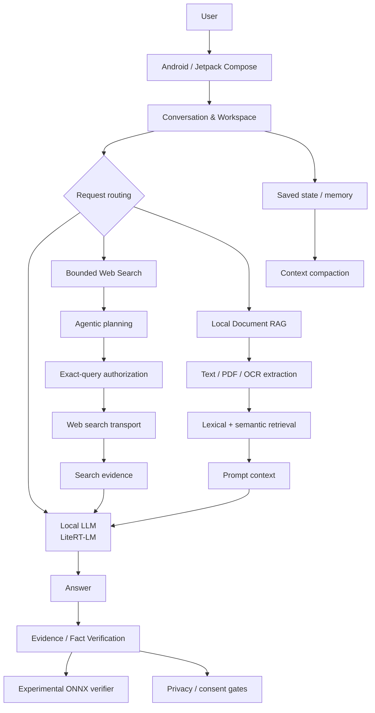

# Fusion

### 검증 가능한 Local-first AI Workspace for Android

**K-AWARDS 2026 · 고등부 · AI 서비스 혁신 출품용 공개 쇼케이스**

Fusion은 Android 기기에서 로컬 LLM을 실행하고, 필요할 때 로컬 문서 RAG·웹 검색·근거 확인·답변 비교·학습/지식 관리 기능을 하나의 작업 흐름으로 연결하는 AI 애플리케이션입니다.

이 저장소는 심사용 **공개 쇼케이스**입니다. 실제 개발 저장소는 연구 산출물, 내부 감사 로그, 실험 데이터와 작업 중 자료가 함께 있어 비공개로 유지합니다.

> **현재 상태:** 작동형 프로토타입 / Beta 성격의 연구·개발 앱  
> **기준 개발 스냅샷:** `transfer/vq8-build-recovery-20261030` @ `08a21622` (2026-11-08)  
> **주의:** Fusion 전체를 상용 배포 준비가 끝난 제품으로 주장하지 않습니다. 하위 기능별 검증 수준은 서로 다릅니다.

---

## 왜 만들었나

모바일에서 LLM을 실행하는 것만으로는 실제 AI 서비스가 완성되지 않습니다.

실사용 환경에서는 다음 문제가 함께 발생합니다.

- 제한된 모바일 메모리와 모델 생명주기
- 긴 대화의 컨텍스트 한계
- 최신 정보가 필요한 질문
- 로컬 문서와 웹 정보의 출처 구분
- 검색 결과의 신선도와 근거성
- 답변을 검증할 때 생기는 개인정보·데이터 외부 전송 문제
- 앱 종료, 취소, 재시도, 저장 실패와 같은 비정상 경로

Fusion은 이 문제들을 각각의 데모 기능으로 분리하기보다, **질문 → 문맥 구성 → 생성 → 검색/근거 → 검증 → 후속 작업** 흐름 안에서 연결하는 것을 목표로 개발했습니다.

---

## 핵심 기능

### 1. On-device LLM 실행

Fusion의 로컬 생성 경로는 Android용 **LiteRT-LM** 런타임을 사용합니다.

실제 코드에는 엔진 생성·재사용·교체·정리, CPU/가속기 설정, 모델 프로필, 취소 및 오류 분류 같은 런타임 소유권 처리가 포함되어 있습니다.

**과장하지 않는 범위**

- 로컬 LLM 실행 경로가 실제 구현되어 있습니다.
- 성능과 사용 가능한 모델은 기기, 모델 형식, 메모리 상황에 따라 달라집니다.
- 모든 모델이 모든 기기에서 동일하게 동작한다고 주장하지 않습니다.

---

### 2. 제한된 Agentic Web Search

Fusion에는 모델이 검색 계획을 세울 수 있는 `AgenticSearchHarness`가 구현되어 있습니다.

검색은 무제한 자율 루프가 아니라 다음과 같이 제한됩니다.

- 요청 단위 검색 권한 확인
- 모델이 제안한 검색어와 실제 외부 전송 검색어의 분리
- 검색어 provenance/authorization 검사
- 제한된 planning round와 query budget
- 취소·timeout·permission revocation 처리
- 결과가 부족할 때도 bounded fallback만 허용

즉, **모델이 임의의 문자열을 바로 네트워크로 보내는 구조가 아닙니다.**

최신 검색 신뢰성 감사 스냅샷에서는 검색·privacy·retry 관련 targeted host suite **644 tests / 0 failures**가 기록됐습니다. 다만 해당 감사 시점의 **physical release qualification은 pending**이었으므로, 이 저장소에서도 검색 기능 전체를 실기기 release-qualified라고 표현하지 않습니다.

---

### 3. Local Document RAG

첨부 문서에 대해 로컬 RAG 경로가 구현되어 있습니다.

현재 코드 기준으로 확인되는 주요 동작은 다음과 같습니다.

- bounded text extraction
- PDF page-aware extraction/retrieval
- OCR image용 문서 경로
- lexical candidate discovery
- KoEn semantic retrieval 보조
- 선택된 chunk/page provenance 보존
- generation 직전 원본 변경 여부 재검증
- 지원하지 않거나 읽을 수 없는 문서를 임의 텍스트로 대체하지 않는 fail-closed 처리

문서 전체를 모델이 읽은 것처럼 과장하지 않도록, 일부 페이지만 사용한 경우 coverage 정보를 별도로 관리합니다.

---

### 4. Evidence & Fact Verification

Fusion은 답변에서 확인 가능한 주장과 근거를 대조하는 Evidence UI 및 verification pipeline을 갖고 있습니다.

사용자는 답변의 **`사실 확인`** 흐름을 명시적으로 실행할 수 있으며, 검색이 필요한 경우에도 bounded targeted search를 사용합니다.

또한 별도의 실험적 semantic verifier backend가 존재합니다.

- runtime: ONNX Runtime
- 입력: evidence + claim pair
- 출력 label:
  - `SUPPORTED`
  - `CONTRADICTED`
  - `INSUFFICIENT`

여기서 `INSUFFICIENT`는 “거짓”이라는 뜻이 아니라 **현재 근거로 판정하기 부족함**을 뜻합니다.

#### Galaxy S24 verifier qualification

비공개 개발 저장소의 최종 qualification report에는 Galaxy S24 (`SM-S921N`, Exynos 2400)에서 verifier Android execution이 **qualified**로 기록되어 있습니다.

- sealed-gold runtime argmax parity: `160/160`
- tokenizer fixture parity: `173/173`
- lifecycle / cancellation / foreground-background / memory-pressure checks 완료
- `android_qualified = true`
- `target_s24_qualified = true`
- `production_distribution_ready = false`

`160/160`은 **동결된 기준 출력과 Android runtime 출력이 일치했다는 parity 결과**이지, “모든 문장을 100% 정확하게 판별한다”는 의미가 아닙니다.

---

### 5. Privacy-aware Data Egress

Fusion은 로컬 문서·프로젝트·RAG에서 나온 private material이 검색어로 외부 전송되는 경로를 별도로 제한합니다.

실제 코드에는 다음 경계가 있습니다.

- attachment / project / local-RAG provenance 감지
- private text 및 local filename 검사
- 요청 단위 permission 재검증
- private-derived targeted search에 대한 consent 경로
- denied consent 시 해당 query의 network call 차단
- post-answer verification에서도 로컬 문서 기반 내용의 웹 검색 제한

이 설계는 “데이터가 절대로 외부로 나가지 않는다”는 절대적 보안 보증이 아니라, **외부 전송 경로를 명시적으로 구분하고 제한하기 위한 애플리케이션 수준의 안전장치**입니다.

---

### 6. Long-context Compaction & Durable Adoption

긴 대화가 모델 컨텍스트 한도를 넘는 문제를 줄이기 위해 대화 compaction이 구현되어 있습니다.

최신 코드에서는 다음을 확인할 수 있습니다.

- 이전 대화를 요약한 compact memory
- compact 결과의 persistent boundary 관리
- branch가 바뀐 뒤 도착한 stale summary 거부
- persistence 실패 시 이전 상태/원문 기반 fallback
- reasoning wrapper가 요약 메모리에 섞이지 않도록 normalization
- summary 실패 시 deterministic whole-turn trimming fallback

따라서 “대화를 무제한 기억한다”고 주장하지 않습니다. 목적은 **제한된 context budget 안에서 이전 맥락을 더 안전하게 유지하는 것**입니다.

---

## Workspace 기능

핵심 AI 파이프라인 외에도 실제 코드 트리에는 다음 UI/데이터 경로가 존재합니다.

- 답변 버전 비교 및 line-level change view
- Study session / progress / review card
- standalone translation
- Saved Knowledge 및 검색
- Project context / project knowledge
- Research refresh queue
- Knowledge hygiene
- Inbox triage
- Decision capture
- Project pulse / action center

각 기능은 개발·검증 성숙도가 서로 다르므로, 이 공개 페이지에서는 **모든 기능이 동일한 수준으로 release-qualified라고 주장하지 않습니다.**

---

## Architecture

---

## 구현·검증 상태

| 영역 | 현재 공개 표현 | 근거가 되는 개발 코드/보고서 | 제한 |
|---|---|---|---|
| Local LLM | 구현됨 | `LiteRtLlmEngine.kt` | 기기/모델별 성능 차이 |
| Agentic Search | 구현 + host hardening | `AgenticSearchHarness.kt`, search qualification report | physical release gate는 감사 시점 pending |
| Local RAG | 구현됨 | `LocalRagCoordinator.kt`, `LocalAttachmentRag.kt` | 지원 형식/추출 가능 여부에 제한 |
| Semantic Verifier | 실험적, S24 Android qualified | `FusionVerifierRuntimeOwner.kt`, `OnnxEvidenceVerifierBackend.kt`, S24 report | production distribution ready는 아님 |
| Privacy egress controls | 구현됨 | `ApplicationSearchStrategyExecutor.kt`, `PostAnswerSearchPrivacy.kt` | 앱 수준 안전장치이며 절대적 보안 보증 아님 |
| Answer Compare | 구현됨 | `ResponseVersionCompareDialog.kt` | line diff이며 사실 판정 기능 아님 |
| Context Compaction | 구현·hardening 진행 | `AutoCompaction.kt`, Phase 4 regression tests | 요약 실패 시 fallback |
| Study / Translation / Knowledge | 구현된 화면·데이터 경로 존재 | 관련 `study`, `translation`, `knowledge` 패키지 | 기능별 검증 성숙도 상이 |

더 자세한 claim 경계는 [`CLAIM_STATUS.md`](./CLAIM_STATUS.md)에 정리했습니다.

---

## 기술 스택

- **Kotlin**
- **Jetpack Compose**
- **Room**
- **LiteRT-LM**
- **ONNX Runtime**
- Local document retrieval / RAG
- Web search & evidence pipeline
- Android instrumentation + host-side regression tests

---

## AI 활용 및 개발 과정

Fusion 개발 과정에서는 ChatGPT/Codex를 포함한 생성형 AI를 코드 검토, 오류 분석, 테스트 아이디어 도출, 문서 정리 등의 보조 도구로 사용했습니다.

앱 자체에서도 로컬 모델 및 외부 모델 후보를 비교·실험했으며, Gemma 계열을 포함해 Qwen, Llama 등 다양한 공개 모델 생태계를 검토했습니다.

AI가 제안한 내용을 그대로 결과물로 간주하지 않고, 실제 Android 코드에 반영되는 변경은 테스트와 코드 대조를 거쳐 판단했습니다.

---

## K-AWARDS 제출 정보

- **부문:** 고등부 · AI 서비스 혁신
- **작품명:** Fusion
- **개발자:** 장준영
- **형태:** Android 작동형 프로토타입
- **공개 저장소 목적:** 심사위원이 작품 구조와 검증 범위를 빠르게 확인할 수 있도록 만든 showcase

---

## Source availability

전체 개발 저장소는 현재 공개하지 않습니다.

비공개 저장소에는 앱 소스뿐 아니라 내부 bug audit, adversarial test 기록, 연구용 verifier 데이터, 실험 중 산출물, 로컬 체크포인트 등이 함께 포함되어 있어 제출용 공개 저장소와 분리했습니다.

이 showcase는 실제 개발 스냅샷과 대조하여 작성했으며, **공개 설명보다 구현 상태가 앞서 보이도록 과장하지 않는 것**을 원칙으로 합니다.

---

## Screenshots / Demo

실제 앱 화면과 시연 영상은 K-AWARDS 제출 자료와 함께 제공할 예정입니다.

`assets/`에는 다음 화면을 우선 배치하는 것을 권장합니다.

1. 메인 채팅 + 로컬 생성
2. 웹 검색 + source/evidence 표시
3. `사실 확인` / Evidence 화면
4. 로컬 문서 RAG
5. Study 또는 Knowledge workspace

---

### Disclaimer

Fusion은 연구·개발 중인 소프트웨어입니다. 이 저장소의 설명은 2026-11-08 기준 개발 스냅샷에 맞춰 작성됐으며, 의료·법률·금융 등 고위험 분야의 전문 판단 도구로 제공되는 것이 아닙니다.
