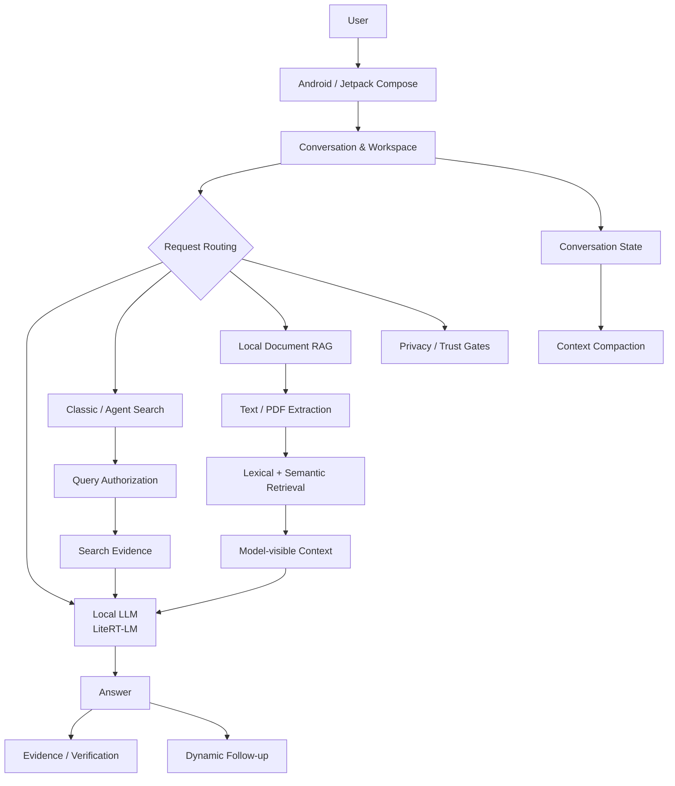

# Fusion

### Local-first AI Workspace for Android

**K-AWARDS 2026 · 고등부 · AI 서비스 혁신 출품작**

Fusion은 Android 기기에서 로컬 LLM을 실행하고, 필요할 때 **로컬 문서 RAG · 웹 검색 · 근거 확인 · 대화 메모리 · 후속 작업**을 하나의 흐름으로 연결하는 AI 애플리케이션입니다.

단순히 “스마트폰에서 LLM이 실행된다”는 데서 끝나지 않고, 실제 사용 과정에서 생기는 **컨텍스트 한계, 검색 근거성, 개인정보 외부 전송, 재시도·취소·대화 전환, RAG 출처 관리**까지 함께 다루는 것을 목표로 개발했습니다.

> **상태:** Android 작동형 프로토타입  
> **버전:** Fusion 2.4.0 (`versionCode 20400`)  
> **K-AWARDS 최종 기준 소스:** `0735731b360a3cb66839e5d523aade9d830ce6ed`  
> **최종 기술 판정:** `READY_FOR_SUBMISSION`  
> **주의:** 연구·개발용 프로토타입이며 상용 배포가 완료된 제품으로 주장하지 않습니다.

---

# 핵심 차별점

> ## **로컬에서 실행하고, 근거를 추적하고, 외부 전송을 통제하는 Android AI Workspace**
>
> Fusion은 단순한 모바일 챗봇이 아닙니다.  
> **온디바이스 LLM · 로컬 문서 RAG · 웹 검색 · 근거 추적 · 긴 대화 메모리 · 개인정보 전송 제어**를 하나의 Android 애플리케이션 안에서 연결했습니다.

### 로컬 최우선 처리
가능한 처리는 기기 내부에서 수행하며, 로컬 문서와 private-derived context가 외부 검색 경로로 넘어가는 과정을 별도로 통제합니다.

### Grounded RAG & 검색
로컬 문서와 웹 검색 결과에 provenance를 유지하고, 근거가 부족할 때는 임의의 답을 만드는 대신 제한적으로 응답하거나 abstention하도록 설계했습니다.

### 롱컨택스트 & 답변 소유권
긴 대화의 context compaction뿐 아니라 답변 재생성, response version 전환, retry 과정에서 **어떤 대화와 어떤 branch의 상태인지**까지 추적합니다.

### 6,000+ 호스트 테스트 + 실기기 검증
최종 frozen candidate에서 **6,085개의 JVM/호스트 테스트**를 실행했으며, Android 실기기에서도 로컬 추론, 대화 소유권, response version, RAG, cancellation, provenance 등을 검증했습니다.

**최종 검증 결과**

`Physical P0 blockers: 0 confirmed` · `Physical P1 blockers: 0 confirmed`  
`PHYSICAL_RELEASE_QUALIFIED_WITH_UTILITY_LIMITATIONS`

## 왜 만들었나

모바일에서 LLM을 실행하는 것만으로는 실제 AI 서비스가 완성되지 않습니다.

실사용 환경에서는 다음 문제가 함께 발생합니다.

- 제한된 모바일 메모리와 모델 생명주기
- 긴 대화의 컨텍스트 한계
- 최신 정보가 필요한 질문
- 로컬 문서와 웹 정보의 출처 구분
- 검색 결과의 신선도와 근거성
- 개인정보·로컬 자료가 외부 검색으로 섞일 가능성
- 답변 재생성·대화 전환 중의 상태 소유권
- 취소, timeout, 저장 실패와 같은 비정상 경로

Fusion은 이 문제들을 각각의 데모 기능으로 분리하기보다, **질문 → 문맥 구성 → 생성 → 검색/근거 → 검증 → 후속 작업** 흐름 안에서 연결했습니다.

---

## 핵심 기능

| 영역 | 구현 내용 |
|---|---|
| **On-device LLM** | LiteRT-LM 기반 Android 로컬 추론 |
| **Local Document RAG** | 텍스트·PDF 추출, lexical + semantic retrieval, provenance 유지 |
| **Classic / Agent Search** | bounded search, query authorization, 제한된 planning/fallback |
| **Evidence / Fact Verification** | 답변과 근거를 확인하는 evidence/verification 흐름 |
| **Context Compaction** | 긴 대화의 이전 맥락을 제한된 context budget에 맞춰 압축 |
| **Response Versions** | 답변 재생성, 버전 전환 및 branch-aware state 관리 |
| **Dynamic Follow-up** | 현재 답변에 기반한 후속 질문 제안 |
| **Privacy / Trust Routing** | private/local-derived context의 외부 전송 경계 관리 |
| **Workspace** | Saved Knowledge, Project context, Study, Research Refresh, Decision Capture 등 |

---

## 1. On-device LLM

Fusion의 로컬 생성 경로는 Android용 **LiteRT-LM**을 사용합니다.

실제 앱에는 모델 프로필, 엔진 생성·재사용, generation cancellation, response ownership, foreground/background 전환과 같은 런타임 수명주기 처리가 포함되어 있습니다.

모델 성능과 실행 가능 여부는 기기 메모리, 모델 형식, runtime profile에 따라 달라집니다. 모든 기기와 모든 모델에서 동일하게 동작한다고 주장하지 않습니다.

---

## 2. Local Document RAG

첨부 문서를 모델 프롬프트에 무조건 전부 넣지 않고, bounded candidate를 만든 뒤 필요한 근거를 선택합니다.

주요 경로:

- text / PDF 기반 문서 추출
- page-aware PDF retrieval
- lexical candidate discovery
- Ko/En semantic retrieval 보조
- selected chunk/page provenance 유지
- generation 직전 source 상태 재검증
- 읽을 수 없는 입력을 임의 텍스트로 대체하지 않는 fail-closed 처리

인접한 이름을 잘못 같은 대상으로 취급하는 문제도 adversarial regression 대상으로 사용했습니다.

```text
P1       vs P10
S24      vs S24FE
삼성전자  vs 삼성전자서비스
```

semantic similarity는 **retrieval ranking 신호**이며 사실 여부를 판정하는 confidence score로 사용하지 않습니다.

---

## 3. Classic / Agent Search

Fusion에는 직접 검색 경로인 Classic Search와 제한된 Agent Search가 있습니다.

Agent Search는 모델이 만든 문자열을 무제한으로 네트워크에 보내는 구조가 아닙니다.

- 요청 단위 search/trust 상태 확인
- 모델 제안 query와 실제 외부 전송 query의 분리
- bounded planning round / query budget
- authorization 및 provenance 검사
- timeout / cancellation / permission 변화 처리
- 불충분한 결과에 대한 제한된 fallback 또는 abstention

최종 실기기 qualification에서는 확인한 Agent 사례의 **admitted source record 2/2와 answer provenance가 일치**했습니다.

다만 현재 Search는 일부 질의에서 **abstention 비율이 높고**, broad-news 출력에서 형식/표현 품질 한계가 관찰되었습니다. 따라서 검색이 항상 답을 내거나 항상 정확한 결과를 제공한다고 주장하지 않습니다.

---

## 4. Privacy-aware Data Egress

로컬 첨부파일, 프로젝트 자료, Local RAG 결과처럼 private/local-derived 가능성이 있는 데이터는 외부 검색 경로와 분리하여 다룹니다.

Fusion에는 다음과 같은 application-level 경계가 있습니다.

- request-scoped trust routing
- attachment / project / RAG provenance 감지
- query authorization
- frozen retry/request ownership
- consent가 필요한 경로의 별도 처리
- 외부 전송 권한이 없을 때 fail-closed 처리

이 설계는 “데이터가 절대로 외부로 나가지 않는다”는 절대적 보안 보증이 아니라, **외부 전송이 가능한 경로를 명시적으로 구분하고 제한하기 위한 안전장치**입니다.

---

## 5. Long-context Compaction

Fusion은 긴 대화를 무제한 기억한다고 주장하지 않습니다.

대신 제한된 context budget 안에서 이전 대화를 compact memory로 바꾸고, 현재 대화 branch와 durable state의 ownership을 검사합니다.

Phase 5 adversarial audit에서는 response-version branch가 달라졌을 때 단순 message ID 크기만으로 durable boundary를 판단하면 정상 branch state까지 거부할 수 있다는 결함을 fail-first test로 확인하고 수정했습니다.

최종적으로:

- 같은 semantic branch의 stale compaction은 durable state를 되돌릴 수 없음
- 정상적인 active response branch는 자신의 valid memory를 사용할 수 있음
- persistence/adoption 실패 시 이전 안전한 상태로 fallback

하도록 검증했습니다.

stale-branch isolation 자체는 host deterministic test로 증명했으며, 내부 durable branch state는 실기기 UI에서 직접 관찰하기 어려워 해당 항목은 host-proven limitation으로 남겨 두었습니다.

---

## 6. Evidence & Workspace

Fusion은 답변 근거를 확인하는 Evidence UI와 별도의 experimental verifier 경로를 포함합니다.

또한 핵심 chat pipeline 외에 다음 기능이 실제 코드베이스에 존재합니다.

- 답변 버전 비교
- Saved Knowledge
- Project context / project knowledge
- Study / review card
- Translation
- Research Refresh Queue
- Knowledge Hygiene
- Inbox Triage
- Decision Capture
- Project Pulse / Action Center

각 기능의 개발·검증 성숙도는 서로 다르므로 모든 기능을 동일한 수준으로 release-qualified라고 주장하지 않습니다.

---

## Architecture



---

## 최종 검증 상태

최종 frozen candidate는 아래 source/APK identity를 기준으로 host 및 실기기 검증을 진행했습니다.

| 항목 | 결과 |
|---|---:|
| Frozen source | `0735731b360a3cb66839e5d523aade9d830ce6ed` |
| Host/JVM tests executed | **6,085** |
| Passed | **6,043** |
| Known baseline failures | **34** |
| Skipped | **8** |
| New host failures after final changes | **0** |
| Physical P0 blockers | **0 confirmed** |
| Physical P1 blockers | **0 confirmed** |
| Physical verdict | `PHYSICAL_RELEASE_QUALIFIED_WITH_UTILITY_LIMITATIONS` |

34개의 host failure는 최종 변경으로 새로 발생한 실패가 아니라 이전부터 별도로 추적하던 동일한 baseline failure set입니다. 최종 비교는 단순 개수뿐 아니라 failing `class.method` identity 기준으로 수행했습니다.

실기기에서는 다음 핵심 경로를 확인했습니다.

- local inference
- conversation ownership
- response versions
- exercised compaction path
- text Local RAG
- nested-entity follow-up / exact-entity RAG cases
- cancellation / process survival
- Agent admitted-source provenance sample

### 남아 있는 제한

- Search의 높은 abstention
- 일부 broad Agent output의 형식/표현 품질 한계
- stale-branch compaction isolation은 host-proven이지만 실기기 내부 state를 직접 관측하기 어려움
- PDF adjacent-entity adversarial case의 최종 physical check는 완료하지 않음
- Agent provenance는 확인한 2/2 admitted source가 일치했지만 모든 raw retrieval identity가 UI에 노출되는 것은 아님

Fusion이 hallucination을 제거하거나 검색 정확성을 보장한다고 주장하지 않습니다.

---

## Evaluation APK

최종 검증에 사용한 APK는 **development-signed evaluation build**입니다.

```text
versionName:    2.4.0
versionCode:    20400
applicationId:  com.projectnuke.fusion

APK size:
294,205,359 bytes

SHA-256:
B2E8CE890E78211A8BF72778331DA1511DC99E68CAF8B72743F8C8B426160D8B
```

이 APK를 production-signed release로 표현하지 않습니다.

---

## 기술 스택

- Kotlin
- Jetpack Compose
- Room
- LiteRT-LM
- ONNX Runtime
- AndroidX PDF
- ML Kit OCR
- Local document retrieval / RAG
- bounded web search / evidence pipeline
- JVM host tests + Android physical qualification

---

## 공개 저장소와 소스

이 저장소는 K-AWARDS 심사를 위해 만든 공개 showcase입니다.

전체 개발 저장소에는 앱 소스 외에도 내부 bug audit, adversarial report, 연구 산출물, 로컬 checkpoint, 로그, development signing key 등이 포함되어 있어 그대로 공개하지 않습니다.

공개용 source snapshot은 최종 frozen source

```text
0735731b360a3cb66839e5d523aade9d830ce6ed
```

을 기준으로 구성하며, application logic은 유지하고 다음과 같은 private/development-only 자료는 제외합니다.

- development signing key
- local checkpoints
- internal audit/work reports
- temporary logs and build outputs
- private credentials / local configuration
- 별도 연구용 산출물

실제 LLM model binary 역시 저장소에 포함하지 않습니다.

---

## AI 활용 및 개발 과정

Fusion 개발 과정에서는 ChatGPT/Codex를 포함한 생성형 AI를 코드 검토, 디버깅, adversarial test 아이디어 설계, 문서 정리에 활용했습니다.

AI가 제안한 내용을 그대로 완성품으로 간주하지 않고, production 변경은 source inspection, deterministic regression test, host qualification 및 Android 실기기 검증을 통해 확인했습니다.

앱 자체에서도 local/external model 후보와 여러 공개 LLM 생태계를 비교하며 개발했습니다.

---

## K-AWARDS 2026

| 항목 | 내용 |
|---|---|
| 부문 | 고등부 · AI 서비스 혁신 |
| 작품명 | Fusion |
| 개발자 | 장준영 |
| 형태 | Android 작동형 AI 프로토타입 |
| 공개 저장소 목적 | 작품 구조와 검증 범위를 심사 과정에서 직접 확인할 수 있도록 제공 |

---

### Disclaimer

Fusion은 연구·개발 과정의 Android AI 프로토타입입니다.

의료·법률·금융 등 고위험 분야의 전문 판단 도구로 제공되는 제품이 아니며, 이 저장소의 공개는 모든 기능의 완전성이나 상용 수준의 신뢰성을 보증하는 의미가 아닙니다.
